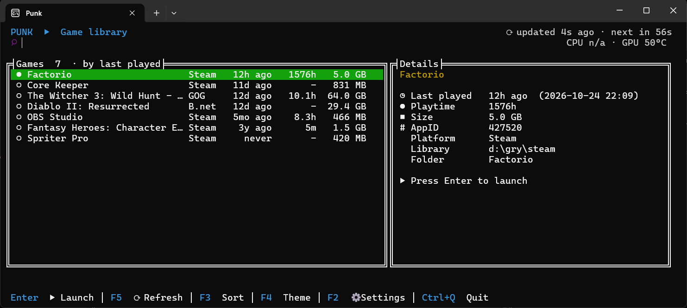

# Punk

**One keyboard-driven terminal launcher for all your installed PC games.**

**⬇️ [Download the latest release](https://github.com/sebszczec/punk/releases/latest)**: Windows installer (`Setup-Punk-<version>.exe`) and Linux build.

Punk scans your Steam, Battle.net and GOG Galaxy installs, shows them in a single list, and starts any of them with Enter. It runs in the terminal, works on Windows and Linux, and is built with C# / .NET 10 and [Terminal.Gui](https://github.com/gui-cs/Terminal.Gui) 2.5.



## Features

- **One library for every launcher**: installed games from Steam, Battle.net and GOG Galaxy in one sorted, searchable list.
- **Type to filter**: start typing to narrow the list, Esc clears the filter.
- **Game details**: last played, total playtime, size on disk, app/product ID, library and install folder.
- **Sorting**: by last played, name, playtime or size (F3).
- **Live session tracking**: after a launch Punk follows the game's own process (Launching → Starting → Playing · 12m → Closed · played 1h 05m) and tells you if the game never started.
- **Auto refresh**: rescans on a timer (60 s by default) and marks newly installed games.
- **Survives missing drives**: games on an unplugged drive or unreachable library stay in the list with a warning instead of disappearing.
- **CPU / GPU temperatures** shown in the header.
- **Themes**: Default (with a custom accent color), Cyberpunk, Colorful and Ambient presets (F4), plus an ASCII-only symbol mode for terminals without good Unicode fonts.

## Supported platforms

| Launcher       | Windows | Linux |
|----------------|:-------:|:-----:|
| Steam          | ✅      | ✅ (native and Proton games) |
| Battle.net     | ✅      | —     |
| GOG Galaxy     | ✅      | —     |

Linux builds are tested on Ubuntu / Zorin OS (x64).

## Getting started

### Requirements

- [.NET 10 SDK](https://dotnet.microsoft.com/download) to build. The published binaries are self-contained and need no .NET install.
- A terminal with Unicode and true color support (Windows Terminal, GNOME Terminal, Konsole, kitty, ...).

### Run from source

```sh
git clone https://github.com/sebszczec/punk.git
cd punk
dotnet run --project Punk
```

### Build standalone binaries

On Windows, `publish.ps1` installs anything missing (.NET 10 SDK, PawnIO driver) via `winget` and publishes single-file builds for both platforms:

```powershell
./publish.ps1
```

Output:

- `dist/win-x64/Punk.exe`
- `dist/linux-x64/Punk`

Installing missing dependencies needs an administrator terminal. To publish by hand on any OS:

```sh
dotnet publish Punk/Punk.csproj -c Release -r linux-x64 --self-contained -p:PublishSingleFile=true -o dist/linux-x64
```

(use `-r win-x64` for Windows).

### Install (Windows)

Download `Setup-Punk-<version>.exe` from the [Releases page](https://github.com/sebszczec/punk/releases/latest) and run it. It installs per user (no administrator rights) into `%LOCALAPPDATA%\Programs\Punk`, adds a Start menu entry, and puts a Punk shortcut on the desktop (untick "Create a desktop shortcut" to skip it). The shortcuts open Punk in a classic console window, so the taskbar shows the Punk icon. Run `Punk.exe` from Windows Terminal if you prefer its look; the taskbar then shows the terminal's icon.

The icon is the [Tabler Icons](https://tabler.io/icons) `device-gamepad-2` glyph (MIT license, see `installer/icon/LICENSE-tabler-icons.txt`).

### Updates

Punk checks GitHub Releases for a newer version at startup (at most every 6 hours). When one is found it is downloaded and verified in the background, and a notice appears under the search box. The update is installed the next time Punk starts, and Punk then relaunches itself on the new version.

- Turn checks off in Settings (F2) with "Check for updates", or set `PUNK_NO_UPDATE=1`.
- Updates apply only to published builds, not to `dotnet run`.

### Releasing (maintainers)

```powershell
./publish.ps1                        # interactive menu
```

The menu asks what to do:

1. **Create a new version.** It checks GitHub and suggests the next patch, minor or major number, or you can type one. Then you choose to release now or build only and release later. Building writes the installer, zips and `SHA256SUMS` to `dist/release/`.
2. **Release a version that was already built.** It refuses if the code changed since the build.

Flags still work for scripts: `-CheckVersion`, `-Version 1.2.0`, `-Bump patch -Release`, and `-NonInteractive` (builds the version in `Punk.csproj` without the menu). Details are in `publish.ps1`.

## Keyboard shortcuts

The bottom bar is clickable too: double-click an item (for example `F3 Sort`) to run it. A single click does nothing.

| Key                     | Action                     |
|-------------------------|----------------------------|
| *type*                  | Filter games by name       |
| Esc                     | Clear the filter           |
| ↑ / ↓, PgUp / PgDn      | Move through the list      |
| Enter                   | Launch the selected game   |
| F5 / Ctrl+R             | Rescan now                 |
| F3 / Ctrl+O             | Change sort order          |
| F4                      | Cycle theme preset         |
| F2 / Ctrl+S             | Settings                   |
| F6                      | Launch options (Steam and GOG games) |
| Ctrl+Q                  | Quit                       |

## Configuration

Everything can be changed in the settings dialog (F2): refresh interval (0 turns auto refresh off), Steam path override, extra Steam library folders, extra Battle.net game folders, enabling or disabling Battle.net / GOG, hiding Steam tools (Proton, runtimes, redistributables), accent color and ASCII symbols.

Settings are stored as JSON in:

- Windows: `%APPDATA%\Punk\config.json`
- Linux: `$XDG_CONFIG_HOME/punk/config.json` (falls back to `~/.config/punk/config.json`)

Steam, Battle.net and GOG are detected automatically. Set paths only if a launcher or library is installed somewhere unusual.

## Temperatures

- **Linux**: read from `/sys/class/hwmon` (k10temp, coretemp, zenpower, amdgpu, nouveau, ...), no extra setup needed.
- **NVIDIA GPUs** (both OSes): read through `nvidia-smi` if it is installed.
- **Windows CPU**: read with [LibreHardwareMonitor](https://github.com/LibreHardwareMonitor/LibreHardwareMonitor), which needs the [PawnIO](https://pawnio.eu/) driver and an **administrator terminal**. Without them Punk falls back to the Windows thermal zone counter, which is less accurate or missing on some machines. Install PawnIO with `winget install namazso.PawnIO` (`publish.ps1` does this for you).

Temperatures are optional: if no sensor is available, Punk just leaves that part of the header empty.

## How it works

Punk only reads launcher data. It never changes launcher files:

- **Steam**: finds the Steam install, reads `libraryfolders.vdf` and the `appmanifest_*.acf` files, and gets last-played times and playtime from the user's `localconfig.vdf`. Games are started through `steam://` URLs.
- **Battle.net**: checks for the executables of known Blizzard games under the client's install folder and any extra folders you add; last-played times come from `Battle.net.config`. Games are started through the Battle.net client.
- **GOG Galaxy**: lists games from the GOG registry entries; playtime and last-played times come from Galaxy's local database, opened read-only. Games are started through the Galaxy client.
- **Running games** are found by watching for processes started from the game's install folder. On Linux this covers Proton / Wine games too.

## Project layout

```
Punk/
  Steam/       Steam detection, VDF parser, scanner, launcher, shared Game model
  BattleNet/   Battle.net scanner and launcher
  Gog/         GOG Galaxy scanner, launcher, playtime stats
  Launch/      Process tracking, session tracker, temperatures, elevation check
  Config/      AppConfig + JSON store
  Ui/          Terminal.Gui main window, settings dialog, themes
tools/SessionTest/   Console test for the session tracker using a fake game process
scripts/             Linux test script (WSL + tmux)
publish.ps1          Dependency check + Windows/Linux publish
```

## Contributing

Issues and pull requests are welcome, especially support for more launchers (Epic, Ubisoft Connect, EA app, Xbox, Lutris, Heroic, ...). A new launcher needs a scanner that returns installed games, a launcher that starts them, and a matching install-folder entry so the session tracker can follow the running game. The Steam, Battle.net and GOG implementations show the pattern.

For automated UI checks, run with `PUNK_SELFTEST=<file>`: Punk runs a scripted key sequence, writes screen snapshots to that file and exits.

## License

Released under the [MIT License](LICENSE): use, copy, modify and distribute it however you like.
